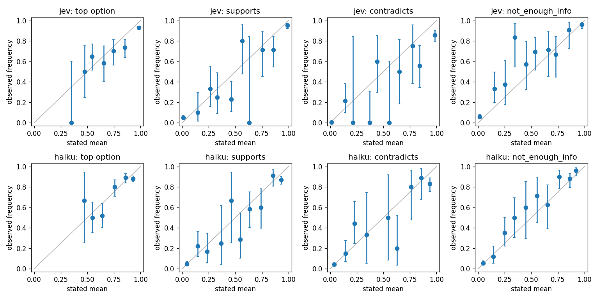
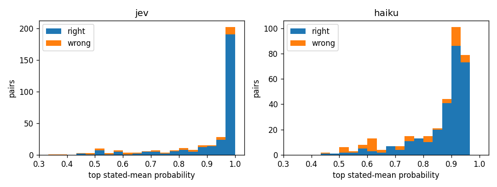

# decision-model-eval

`Python | SQLite | OpenRouter | NumPy | matplotlib | pytest`

Decision models answer a typed question (yes/no, a choice, a score) with a probability for every option, and TypeSafe sells its decision model, Jev, as calibrated: *"higher confidence means higher accuracy."* If that holds, a workflow can set its working point, the confidence above which it acts without a human, straight from the stated probability and the cost of an error. If it doesn't, the working point has to be measured on labeled data from the workflow itself.

Two independent evaluations have already checked the claim on benchmarks, and both found that calibration depends on the task ([Prior work](#prior-work)). This project asks the question a team adopting one of these models would ask: **on my own decisions, can I take the stated probability at its word, or do I still have to measure the working point?** It measures that at the judgment points of a live agentic workflow, the author's own job-search pipeline, against blind human labels and a non-model baseline. A public control set runs on the same backends, so the shift from benchmark to live data is measured rather than assumed.

**Status (2026-10-21).** The control result is in: [SciFact](#first-result-the-scifact-control-run), 339 claim-verification pairs, Jev against Claude Haiku 5.5. The live measurement is [being collected](#the-live-measurement-in-progress). The data capture, the blind weekly labels and the decision client are built, and the shadow runs and the analysis come next.

**What this demonstrates:**

- **Evaluation design for model-driven decisions** - a control set before the live result, labels made blind to model output, working points selected on one split and reported on another, and the biased "oracle" number shown only as a labeled upper bound.
- **Calibration measured with honest uncertainties** - reliability diagrams with Clopper-Pearson intervals, a proper scoring rule beside binned error, a simulated noise floor for that error, and utility at a stated error cost.
- **A reproducible model-call harness** - pinned model versions and reasoning effort, pinned serving providers, one logged and replayable record per call, and hashed question wording, so an analysis refuses to mix versions.
- **Data capture for a live workflow** - a SQLite store that keeps every fetched record, filter rejects included, with the search configuration versioned.

> Developed using Claude Code; `CLAUDE.md` contains the technical context file for AI-assisted
> sessions - see [Agent-assisted development](#agent-assisted-development).

---

## Prior work

- **vals.ai, [An Independent Evaluation of TypeSafe's Jev](https://www.vals.ai/blogs/independent-evaluation-of-jev) (2026-10-06).** Twelve systems, Jev 1.13.0 among them. Jev's expected calibration error (ECE) was 0.011 on 400 claim-verification items built from recent 10-K filings, the lowest of the twelve, and 0.108 on a 396-question LegalBench slice, the highest. The post notes that part of that rise is mechanical, since error grows as accuracy falls. Its routing test uses the threshold protocol used here: each threshold is set on the first 30% of items to meet a 1% error budget, frozen, and applied to the other 70%. Six of the twelve systems went over budget, Jev among them (95% of cases automated at 1.6% error).
- **Artificial Analysis, [Decision Index v1.0](https://artificialanalysis.ai/articles/artificial-analysis-decision-index) (2026-10-13).** Across almost all probability levels, accuracy falls below the stated probability for every decision model on the index, driven by the knowledge and reasoning tasks. Most of the models are relatively well calibrated on tool calling and classification.
- **TypeSafe's own operating docs** ([Confidence](https://docs.typesafe.ai/confidence.md)) already say to measure the working point: *"The correct threshold values depend on your domain and the performance of the model for your use case. Start with conservative thresholds, test with your own data, and adjust as you observe results."* The calibration claim is in the launch post, not in the docs.

**What this project adds.** Both evaluations measure benchmarks. This one measures the decisions of a single live workflow, against labels from the person the workflow serves, with a control set run on the same backends. It also puts a purpose-built decision model beside a small general model that states its own probabilities.

---

## First result: the SciFact control run

### Setup

- **Data.** The [SciFact](https://github.com/allenai/scifact) dev set (Wadden et al., 2020): 339 (claim, abstract) pairs, 138 *supports*, 71 *contradicts*, 130 *not enough info*. The release is fetched and checked against a SHA-256 pin, never redistributed.
- **Question.** One 3-option choice per pair, the same wording for both backends:

  ```
  Judge from the abstract alone, not from what you know about the topic:
  does the abstract give evidence that the claim is true or false?
    supports         The abstract gives evidence that the claim is true.
    contradicts      The abstract gives evidence that the claim is false.
    not_enough_info  The abstract gives no evidence either way.
  ```

  A 2-option variant (*supports* vs *does_not_support*) goes to Jev alone on a seeded 100-pair subset, to test what its `confidence` field is.
- **Backends.** Jev 1.14 (`typesafe/jev-1.14-20261014`) through its typed-question endpoint, and Claude Haiku 5.5 at `medium` reasoning effort, which states a probability for every option through strict JSON-schema output. Both are called through OpenRouter, with the model version, effort level and serving provider pinned and logged on every call. Sampling runs at each model's default: `temperature` is never sent, since the 5.5 models reject it.
- **Score.** Each pair is asked 5 times per backend, and the score is the mean of the 5 stated probability vectors. Rates carry $1\sigma$ Clopper-Pearson intervals.
- **Why a control.** SciFact is public, labeled, and very likely in both models' training data. It's the friendly case: the claim is about this set only, and calibration here is a best case for unseen data, not evidence about it.

### Results

| | Jev 1.14 | Haiku 5.5 (medium effort) | Majority class |
|---|---|---|---|
| Accuracy (5-repeat mean) | 85.5% (+1.9 / -2.2) | 82.9% (+2.1 / -2.3) | 40.7% (*supports*) |
| Accuracy (single call) | 85.0% (+0.9 / -0.9) | 82.8% (+0.9 / -1.0) | |
| Top-label ECE (10 bins) | 0.064 | 0.051 | |
| ECE of a perfectly calibrated model with the same scores (mean; 95th percentile) | 0.027; 0.042 | 0.034; 0.053 | |
| Classwise ECE | 0.057 | 0.038 | |
| Brier score (lower is better) | 0.226 | 0.265 | |
| Realized cost per call | \$0.000033 | \$0.00019 | |
| Median latency | 280 ms | 1.6 s | |

The whole run was 3,890 calls, none failed, for \$0.40. The noise-floor row is a seeded simulation: 4,000 draws of outcomes from each backend's own stated top probabilities, scored the same way. The full tables are in [`results/scifact-m4-dev/summary.md`](results/scifact-m4-dev/summary.md), generated from [`results.json`](results/scifact-m4-dev/results.json).





### Working points

Each backend's top probability decides whether to act on its answer or escalate the item. An acted-on answer scores +1 if right and $-c$ if wrong, and an escalated item scores 0. If the probabilities are honest, acting pays exactly when $p \ge c/(1+c)$, so $c$ = 1, 3 and 9 mean thresholds of 0.5, 0.75 and 0.9. SciFact has no real error cost, so the three values of $c$ were fixed by the thresholds they imply, before the run. Three rows per backend and cost:

- **Stated** - the threshold is $c/(1+c)$, with nothing tuned. This row takes the probabilities at their word.
- **Frozen** - the threshold that maximizes utility on a seeded, label-stratified half of the pairs (169), frozen and reported on the other half (170). Every distinct score is a candidate threshold.
- **Oracle** - tuned on the reporting half itself. It's a biased upper bound, shown only for scale.

All rows are on the 170-pair reporting half. Cells give coverage / accuracy of the answered pairs / utility per pair.

| Backend | $c$ | Stated | Frozen (threshold) | Oracle utility |
|---|---|---|---|---|
| Jev | 1 | 98% / 88.0% / +0.74 | (0.56) 94% / 88.8% / +0.73 | +0.75 |
| Jev | 3 | 88% / 91.9% / +0.59 | (0.85) 82% / 92.8% / +0.58 | +0.61 |
| Jev | 9 | 75% / 94.5% / +0.34 | (0.95) 71% / 95.0% / +0.35 | +0.44 |
| Haiku | 1 | 99% / 84.0% / +0.68 | (0.63) 94% / 86.8% / +0.69 | +0.71 |
| Haiku | 3 | 87% / 89.9% / +0.52 | (0.65) 92% / 87.9% / +0.48 | +0.52 |
| Haiku | 9 | 61% / 91.3% / +0.08 | (0.94) 15% / 96.0% / +0.09 | +0.14 |

### Findings

1. **Both backends are far above the majority baseline, and the accuracy gap between them isn't significant.** On the 39 pairs where exactly one of them is right, Jev is right on 24 and Haiku on 15 (exact McNemar test, $p$ = 0.2).
2. **On this set, the stated probability set the working point as well as tuning did.** At every cost, the stated row is within about 0.04 utility per pair of the frozen row, the net of a handful of answers out of 170.
3. **But neither backend's probabilities hold at face value at the top end.** Jev states 0.95 or more on 222 of the 339 pairs, with a mean of 0.990, and is right on 94.1% of them. Haiku states 0.9 or more on 195 pairs, with a mean of 0.930, and is right on 88.2%. Jev's ECE is above the 95th percentile of its noise floor, and Haiku's sits just under it. The stated rule worked in finding 2 because the break-even accuracy at $c$ = 9 (90%) is below what both backends deliver there. A workflow that needed 98% wouldn't get it from Jev's top scores: the 176 pairs it states at 0.98 or more are right 93.2% of the time. **That gap is what a working point measured on labeled data catches and a stated threshold doesn't.**
4. **The two differ in shape.** Jev pushes most pairs to the top, while Haiku never states more than 0.96. So at $c$ = 9, Jev answers 75% of the pairs at 94.5% accuracy (+0.34 per pair), while Haiku's best row nets +0.09: its tuned threshold answers only 15% of the pairs, and its stated threshold answers 61% at a thin margin over break-even.
5. **Haiku reads contradiction as support.** It answered *supports* on 14 of the 71 *contradicts* pairs (Jev: 3), and 10 of those are among its 23 errors at 0.9 or above. Both backends read evidence into no-evidence abstracts about equally often (Jev 26, Haiku 25, of 130).
6. **Jev's `confidence` is its rescaled top probability**, $(K p_{\max} - 1)/(K - 1)$ for $K$ options. It matches exactly on the 500 2-option calls and to within 0.005, rounding, on the 1,695 3-option calls, so it carries no information beyond the probabilities.
7. **The repeats add little.** Single-call accuracy is within 0.5 points of the 5-repeat answer, and the answer changes across repeats on 3% (Jev) and 7% (Haiku) of pairs. The vote fraction is much worse calibrated (top-label ECE about 0.15; [diagram](results/scifact-m4-dev/reliability_vote.png)) because 5 votes are nearly always unanimous. The stated probability carries the signal.
8. **No calibration ranking.** Haiku's ECE is lower but Jev's Brier score is better (sharper and more accurate), and the ECE difference between them isn't tested. Comparing with vals.ai's 0.011 isn't like for like either: a different claim set, Jev 1.13 rather than 1.14, and possibly different binning.
9. **Haiku costs 5.8 times as much as Jev per call** (realized cost as billed by OpenRouter), more than double the ratio of their input list prices, because Haiku also pays for output and its prompts are longer. It used no reasoning tokens on 61% of calls.

### Scope and limitations

- **The claim is about SciFact.** It's a friendly control, very likely seen in training, and nothing here generalizes to other data without measuring it.
- **Small classes.** 339 pairs, and 36 *contradicts* pairs in the reporting half, so per-class numbers carry wide intervals. SciFact's 919 labeled train pairs are the add-on if the intervals need narrowing.
- **One wording, one version each.** Sensitivity to rewording and to model updates (the systematic uncertainty) isn't measured yet. The published evaluations ran Jev 1.13, and this run used 1.14.
- **Hosted models.** A rerun draws new samples, and the provider can change what it serves under a pinned name, so reruns agree within the statistical uncertainty at best.
- **Per-pair model outputs aren't published,** only aggregates.

---

## The live measurement (in progress)

**The workflow.** Once a week, a Claude Code session (Claude Opus 5.5 at high reasoning effort) pulls job listings from public job-board APIs, a startup job board and email alerts, applies keyword filters, and triages what survives into a short queue. The author reads that queue and decides what to apply to. It's the opposite of a mass-apply tool: low volume, every application tailored, and a person at every gate. Each judgment the session makes inline is pulled out into an explicit question that any backend can answer:

| ID | Decision | Shape |
|---|---|---|
| D1 | From the listing line alone: worth reading the full job description? | yes/no |
| D2 | Hard gates on the full job description - seven yes/no questions from a written rubric (e.g. does it require an active security clearance?) | 7 x yes/no |
| D3 | Which of four target lanes the role falls in | choice |
| D4 | Fit with the search's thesis: on-thesis, a skill bridge, or neither | choice |
| D5 | Tier, asked directly and also computed from the D2-D4 answers, to see which agrees better with the human | choice |

**Built so far:**

- **A listings store** (SQLite, outside the repo): every fetched listing, filter rejects included, with the verbatim source record, every search query and its reported vs fetched counts, and the search configuration as a versioned record. Results only hold inside the population the search lets through, so the search is part of the measurement.
- **The incumbent, recorded.** The session's own judgments are stored as backend `claude-inline`, with its reasoning effort as part of its identity, since effort moves judgments as much as a model version does.
- **Blind labels.** Each week the author labels a seeded random sample of about 30 listings drawn from everything fetched, before seeing any model output: D1 from the listing line, then D2 and D5 on the verbatim job description of the listings the author marked worth reading.
- **The decision client** behind the control run, with one logged, replayable record per call.

**Next:**

- **Shadow mode.** Jev, Haiku and a strong-model labeler (Claude Opus 5.5) answer the same questions beside the session, which stays the decision-maker. A backend that is still being measured must not steer the pipeline it's measured on, because its errors would shape what the author reads and labels.
- **Strong-model labels with a scale factor.** The Opus labels cover every listing; their measured agreement with the blind human sample corrects them.
- **A keyword baseline** for the D2 gates, so backends are reported as a gain over the simple alternative.
- **Working points at an asymmetric cost.** A missed good listing costs far more than one wasted read.

The store, the labels, the job descriptions and per-listing decisions stay private. The published result will be aggregate.

---

## A physics analysis as a lens

The study is laid out like a particle-physics analysis, which is the author's background. For a reader who knows one side:

| This study | Physics analysis |
|---|---|
| Search configuration (sources and queries) | Trigger |
| Pass rate at each decision point | Cutflow |
| Keyword-rule baseline | Cut-based baseline |
| Strong-model labels vs the human's labels | Simulated truth vs data |
| Their measured agreement; the threshold set on the workflow's own data | Scale factor; working point |
| SciFact | Control region |
| Labeling before seeing model output | Blinding |
| Frozen vs oracle threshold | Unbiased vs biased selection |
| Run-to-run noise | Statistical uncertainty |
| Sensitivity to question wording and model version | Systematic uncertainty |
| An occasional run with a looser search | Trigger efficiency |

---

## Reproducing the control run

Needs Python 3.12 and an [OpenRouter](https://openrouter.ai) API key. The run costs about \$0.40 and takes about 8 minutes on 8 workers.

```bash
conda create -n decision-model-eval python=3.12
conda activate decision-model-eval
pip install -e .
export OPENROUTER_API_KEY=...          # read from the environment, never from a file

dme scifact download                   # fetch the pinned SciFact release
dme scifact run --name m4-dev          # 3,890 calls; resumes if interrupted
dme scifact report --name m4-dev       # results.json, summary.md, figures
```

Data and runs go under `scifact_dir` in `config.yaml` (`~/.local/share/decision-model-eval/scifact` by default), outside the repo. Every call is appended to a JSONL decision log as it returns, and `dme replay` re-asks a log's inputs against any backend.

For development, `pip install -e . -r requirements-dev.txt`, then `pytest`, `ruff check src/ tests/` and `mypy src/ tests/`. The tests replay canned live responses, so the suite never touches the network.

## Repository layout

```
src/decision_model_eval/
  backends.py        pinned model ids, effort, provider and endpoint per backend
  questions.py       typed questions and their wording hashes
  client.py          decide(): one question per call, retries, logging
  decision_log.py    append-only JSONL log, one line per attempt
  replay.py          re-ask a logged decision against another backend
  calibration.py     reliability curves, ECE, Brier
  thresholds.py      frozen / oracle threshold protocol
  stats.py           Clopper-Pearson intervals
  scifact.py         pinned download, frozen questions, resumable run
  scifact_report.py  results.json, summary.md and figures
  store.py, ingest.py, record.py, sample.py, view.py, surfaced.py
                     the listings store, its ingest, and the blind label draws
  cli.py             the dme command
results/scifact-m4-dev/   the control run's aggregate results
tests/                    pytest, one file per module
```

---

## Agent-assisted development

The code was written with an LLM coding agent (Claude Code) in the loop, and the two files that make that workable are tracked deliberately.

**`CLAUDE.md` is the agent contract.** Its core is a *Locked Decisions* table: pinned model versions and effort levels, pinned serving providers, the threshold protocol, the store's privacy rule. Each carries the reason it was chosen, so an agent with no memory of the argument doesn't re-derive a settled choice into a more conventional and less correct one.

**`.claude/settings.json` is the verification gate.** A hook runs ruff, the full pytest suite and mypy after every edit the agent makes, and returns any failure to the agent in the same turn, while it still has the reasoning that produced the change.

**What that doesn't cover.** The checks show that the code does what its tests say. Whether a threshold was selected on the wrong split, or a label could have seen model output, is a methodology question. The evaluation design and every locked decision are the author's.

## Credits

- **SciFact:** D. Wadden, S. Lin, K. Lo, L. L. Wang, M. van Zuylen, A. Cohan and H. Hajishirzi, *Fact or Fiction: Verifying Scientific Claims*, EMNLP 2020. Claims under CC BY 4.0, abstracts under ODC-By 1.0.
- The Clopper-Pearson intervals and the frozen / oracle threshold protocol are adapted from the author's [atlas-classifier](https://github.com/dshope11/atlas-classifier).

## License

MIT - see [LICENSE](LICENSE).
